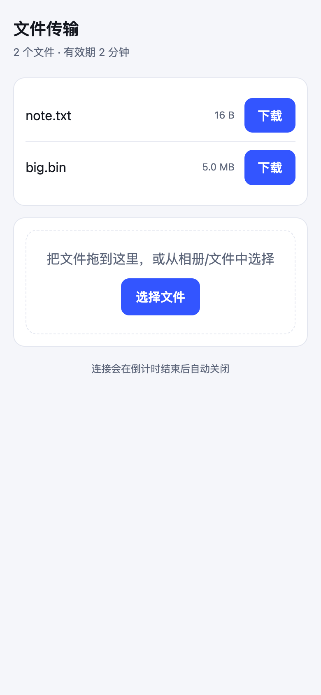

# xfer

给 agent 用的文件传输 CLI：零依赖（Node 内置模块）、JSONL 输出、非交互、失败非零退出。

- **v0.2** 安全默认值：默认不暴露局域网、一次性链接、短有效期、猜解限速、敏感文件拒绝。
- **v0.3** 同时兼容电脑 / 手机 / 平板：网页下载页、6 位短码、终端二维码、**反向上传**（手机 → 本机）。

```bash
xfer -h                 # 顶层说明（含设备与安全默认值）
xfer send -h            # 发送端全部参数
xfer recv -h / info -h
```

## 安装

单文件、零依赖；每个版本一个文件，软链切换，可回滚。**不要 `curl | sh`**——先下载、校验、再执行：

```bash
curl -fsSLo /tmp/xfer-install.sh \
  https://cdn.jsdelivr.net/gh/xylipei/xfer@v0.3.1/install.sh
sh /tmp/xfer-install.sh --version 0.3.1 \
  --sha256 0033fa876a99aac71989c270102dd88c74f821aa975cc2c26541c106569f50ee
```

installer 会再下载 `xfer.mjs` 并核对 release 里的 `SHA256SUMS`：

```
510cc07cadafb813ee3b7e99c570c02fda03ccfff11d908b3bded4c070e5cfd4  xfer.mjs
```

检查更新 / 回滚：

```bash
sh /tmp/xfer-install.sh --check --version 0.3.2   # 退出码 0=已最新 1=该升级
sh /tmp/xfer-install.sh --rollback                 # 退回上一版
xfer doctor                                        # 版本 / proto / 装在哪 / 是否被 PATH 遮蔽
```

给 agent 用：把 `SKILL.md` 放进 skills 目录（DSH: `~/.dsh/skills/xfer-transfer/SKILL.md`），
它会自己判断「装/升级/直接用」，并按协议版本拒绝混版传输。

## Windows：开箱即用

Windows 没有 shebang，文件是否可执行取决于扩展名；因此这里额外提供两样东西：

- `install.ps1`：一条命令装好（校验、版本并存、生成 shim、写 PATH、可回滚）
- `xfer.cmd`：手动安装时用的入口壳，直接调用 `xfer.mjs`

```powershell
irm https://cdn.jsdelivr.net/gh/xylipei/xfer@v0.3.1/install.ps1 -OutFile $env:TEMP\xfer-install.ps1
powershell -ExecutionPolicy Bypass -File $env:TEMP\xfer-install.ps1 `
  -Version 0.3.1 -Sha256 <xfer.mjs 的 sha256>
```

装完之后**新开一个终端**，`xfer -V` 就能用。装到 `%LOCALAPPDATA%\xfer`，不需要管理员：

```
%LOCALAPPDATA%\xfer\versions\xfer-0.3.1.mjs   # 历史版本，回滚用
%LOCALAPPDATA%\xfer\current.mjs                # 当前生效
%LOCALAPPDATA%\xfer\bin\xfer.cmd              # PATH 里的入口（chcp 65001，中文名不乱码）
```

已经装过的机器升级：

```powershell
xfer doctor                                     # 看清 installPath / onPathMatches
powershell -ExecutionPolicy Bypass -File $env:TEMP\xfer-install.ps1 -Check -Version 0.3.1   # 0=最新 1=该升
```

Windows 上三个已知差异：

| 现象 | 原因 | 处理 |
|---|---|---|
| 双击 `xfer` 弹「选择应用」 | 无扩展名文件没有可执行语义 | 用 `xfer.cmd`（或 `node xfer.mjs`），这就是 shim 存在的理由 |
| 手机连不上 | 防火墙拦截入站 | 弹窗时允许「专用网络」；或 `netsh advfirewall ... localport=<port>` |
| `*.local` 打不开 | Windows 默认无 mDNS | `mdnsUrl` 直接为 `null`，用 `baseUrls` 里的 IP |

## 设备兼容矩阵

| 设备 | 怎么用 | 需要装东西吗 |
|---|---|---|
| 电脑（macOS / Windows / Linux） | `xfer recv "<url>"`，或浏览器打开同一 URL | CLI 需要 Node ≥ 20；浏览器不需要 |
| 手机（iOS / Android） | 打开 `phoneUrl`（`?k=` 6 位短码）或扫 `--qr` 二维码 | **不需要**，Safari / Chrome 直接收发 |
| 平板（iPadOS / Android） | 同手机；iPadOS 还支持把文件拖进网页 | **不需要** |
| 任意设备上传到本机 | 页面上「选择文件」/ 拖放，落到 `--upload` 目录 | **不需要** |



同一份 HTML 在桌面宽度下是卡片网格：[桌面截图](docs/xfer-desktop.png)。

## 三种典型用法

```bash
# 1) 只给电脑：默认回环，最安全
xfer send ./report.pdf

# 2) 给手机：局域网 + 网页 + 二维码 + 接收上传
xfer send ./photos --lan --web --qr --upload ./inbox --ttl 900

# 3) 跨网络：不要 --lan，走 SSH 隧道（进程仍只绑回环）
xfer send ./report.pdf --port 8792
ssh -L 8792:127.0.0.1:8792 user@your-mac     # 在远端执行，然后打开 http://127.0.0.1:8792/?k=…
```

## 手机端细节（都是踩过的坑）

- **不用敲 token**：ready 里的 `phoneUrl` 是 `http://<ip>:<port>/?k=6位码`，6 位、去掉 `0/o/1/l/i`，在手机上十秒能打完。
- **二维码**：`--qr` 调 `qrencode` 往 **stderr** 打印 ANSI 二维码（stdout 留给 JSONL）。没装就退回打印 URL，不报错。
- **域名**：还给了 `mdnsUrl`（`http://<主机名>.local:<port>/?k=…`），IP 变了也能用；iOS 首次访问会弹「允许本地网络」，点允许。
- **iOS 下载**：走 `Content-Disposition` + `Content-Length`，文件进「文件」App；Safari 锁屏会挂起下载，超大文件请保持前台，中断后 `Range` 续传。
- **上传**：页面用 `PUT /u/<name>`，直接拿 `File` 对象流式上传，相册、文件、多选都支持；同名**永不覆盖**，自动变 `name-1.ext`。
- **macOS 防火墙**：`--lan` 首次运行时系统会问「是否允许传入连接」，拒绝就只能在回环用。

## 安全模型

| 威胁 | 对策 | 残余风险 |
|---|---|---|
| 同网段扫端口就下载 | 默认绑 `127.0.0.1`；暴露必须显式 `--lan` | 开了 `--lan` 后同广播域可探测端口 |
| 口令爆破 | token 128 位；短码 6 位同权限；同一 IP 5 次错误 → 30s 429 | 短码空间 32⁶≈10⁹，限速下不可行；多 IP 轮换可绕限速 |
| 链接被转发 / 长期有效 | 默认一次性 + `--ttl 600` | 未使用前仍有效 |
| token 入日志 | 服务端只记 IP / 文件名；**永不记 token 或短码** | `?t=`/`?k=` 会进浏览器历史 |
| 误发密钥 | 默认拒绝 `.env`、`~/.ssh/*`、`*.pem` 等 | 只覆盖常见命名 |
| 恶意上传 | 上传需 token/短码；文件名清洗（去路径、去 `..`、去控制符）；`--max-upload` 超限 413 并删临时文件；落盘目录固定、不覆盖 | 有 token 的人可上传；靠目录权限和 TTL 收敛 |
| 内容被篡改 | 下载后 sha256 校验，不符即删；上传回包带 sha256 | 明文 HTTP 只保证完整性，不保证机密 |
| 路径穿越 | 下载按文件名白名单查表；上传强制 `basename` | — |
| 网页 XSS | 页面 CSP `default-src 'none'`，数据以 JSON 注入；文件名不过 `innerHTML` | 页面内联脚本仍要 `unsafe-inline` |

明确不做：账号体系、E2E 加密协议、NAT 打洞。要机密性用 `--tls-cert` 或 SSH 隧道。

## 输出契约

每行一个 JSON；失败非零退出并打印 `error`。

| event | 含义 |
|---|---|
| `ready` | `token` / `code` / `urls` / `baseUrls` / `phoneUrl` / `mdnsUrl` / `files[].sha256` / `web` / `upload` |
| `warn` | 局域网暴露、明文 HTTP、开启上传 |
| `transfer` / `served` | 传输中 / 某文件传完 |
| `denied` | `reason` = `bad-token` \| `cidr` \| `limit` \| `upload-size` |
| `blocked` | 连续错误 token/短码，IP 封 30s |
| `upload` | 收到一个上传：`file` / `bytes` / `sha256` / `ip` |
| `download` / `verified` / `skip` / `done` | 接收端生命周期 |
| `error` | 失败，含 `message` 与可选 `hint` |

退出码：`0` 成功 · `1` 运行错误 · `2` 用法错误。

## 版本与更新

### 两个版本号，别混

- `version`（0.3.0）：功能版本，随便动。
- `proto`（1）：**线协议**。只有破坏旧对端（路由、鉴权参数、JSON 形状变了）才 +1。

两者都在 `xfer -V`、`ready`、`/index.json` 里。接收端会对比 `proto`：

```json
{"event":"error","message":"protocol mismatch: peer speaks proto 99, this xfer speaks 1",
 "hint":"upgrade one side; upgrading the sender first is safest","peerApp":"9.9.9"}
```

**拒绝对端，而不是猜**——混版失败是一条可读的错误，不是校验和不匹配那种灵异现象。

### 安装布局：版本并存 + 软链

```
~/.local/xfer/versions/xfer-0.3.0.mjs   # 每个版本一个文件，永不覆盖
~/.local/xfer/versions/xfer-0.4.0.mjs
~/.local/bin/xfer -> .../xfer-0.4.0.mjs # 唯一入口
~/.local/xfer/current                   # 0.4.0
~/.local/xfer/previous                  # 0.3.0
```

```bash
install.sh --version 0.4.0 --sha256 <hex>   # 装/升级（幂等）
install.sh --check  --version 0.4.0         # 0=已是最新 1=需要升级
install.sh --rollback                        # 一条命令退回上一版
xfer doctor                                  # 版本/proto/装在哪/是否被 PATH 遮蔽
```

`doctor` 里 `onPathMatches:false` 是个真实陷阱：升级装到了新位置，但 shell 仍解析到旧副本——agent 会以为升级无效。

### 升级顺序

1. **先升发送端**（新版本既能服务旧端，也能服务新端）；2. 再升接收端。
   反过来也兼容，但错误信息会先出现在接收端，排查顺序更绕。
3. 升级前跑 `xfer doctor`，确认两端 `proto` 一致；不一致时**不要**开始传输。

### 分发侧约定

- **tag 不可变**：`v0.3.0` 永远指同一份字节。要改就发 `0.3.1`；jsDelivr/CDN 按 tag 缓存，移动 tag 只会让缓存骗人。
- **旧版本不删**：回滚依赖它们。
- 仓库放一个 `latest.json`（`{version, proto, sha256, url, notes}`），skill 读它判断是否需要升级，避免抓 GitHub API 限流。
- CI 在打 tag 时：跑 `test.sh` → 生成 `SHA256SUMS` → 发 release → 更新 `latest.json`。
- 安装命令永远带版本号（`@v0.4.0`），只有“检查更新”才用 `latest.json`。

### Windows 校验

`install.sh` 是 POSIX 的。Windows 用：

```powershell
Invoke-WebRequest $url -OutFile "$env:TEMPþr.mjs"
(Get-FileHash "$env:TEMPþr.mjs" -Algorithm SHA256).Hash -eq $expected
```

装到 `%LOCALAPPDATA%\xfer\bin`，再用一个 `xfer.cmd` 包 `node xfer.mjs %*`。

## 自测

`./test.sh` → **41 passed, 0 failed**。覆盖帮助与用法、默认回环、401/403/410/413/429、
断点续传、sha256、一次性限制、CIDR 白名单、TLS、网页与短码、上传（含拒绝覆盖、大小上限、未开启）。

## 边界

- 单向为主：下载是「发送端 → 接收端」，上传只写进 `--upload` 指定的目录。
- 大文件流式传输，内存与体积无关。
- 没有目录模式：只能发显式列出的文件。
- 二维码依赖系统 `qrencode`（可选，没有就打印 URL）。
